# Architecture

## Overview

The MVP is a local-first monorepo with a React web client, a Fastify API, shared contracts, SQL migrations, and an optional full local runtime stack behind Caddy.

## High-Level Components

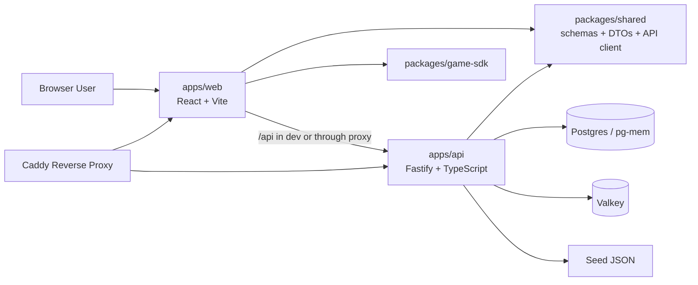

## Monorepo Structure

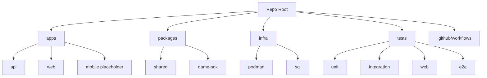

## Runtime Modes

### Direct development mode

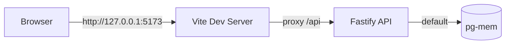

Characteristics:
- fastest local feedback loop
- no Caddy required
- data resets when the API restarts unless a real `DATABASE_URL` is configured

### Full local stack mode

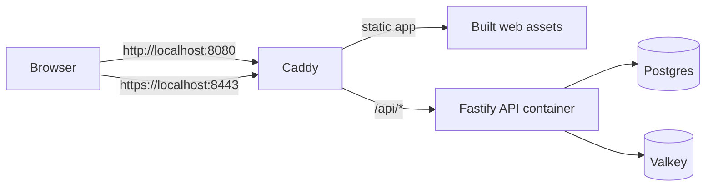

Characteristics:
- proxied production-like local flow
- persistent database
- local HTTPS through `tls internal`

## Backend Design

Main backend layers:
- config loading
- server bootstrap
- auth service
- route handlers
- repository layer
- migrations and seed runner

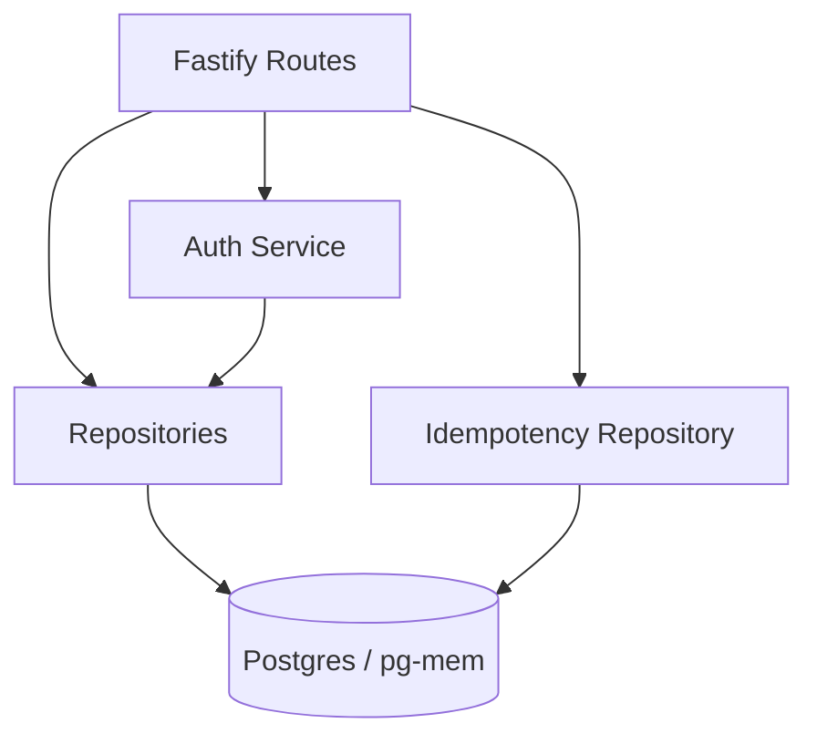

### Auth model

- access tokens: JWT
- refresh tokens: opaque tokens stored server-side
- protected routes use Bearer authentication
- refresh/logout invalidate refresh state on the server

### Progress write model

- progress writes require `Idempotency-Key`
- server stores idempotency records in Postgres
- client retries safely after reconnect

## Frontend Design

Main frontend pieces:
- auth provider
- routed application shell
- game registry
- flashcards page
- offline queue
- local progress helpers

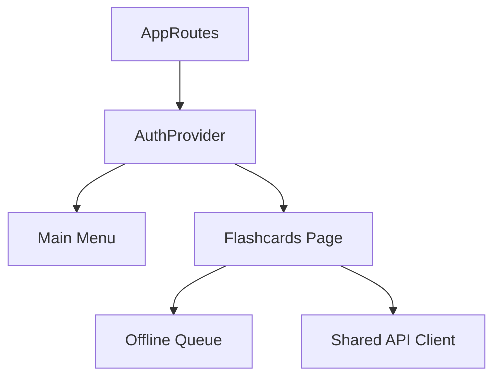

## Data Model

Core persisted entities from the MVP schema:

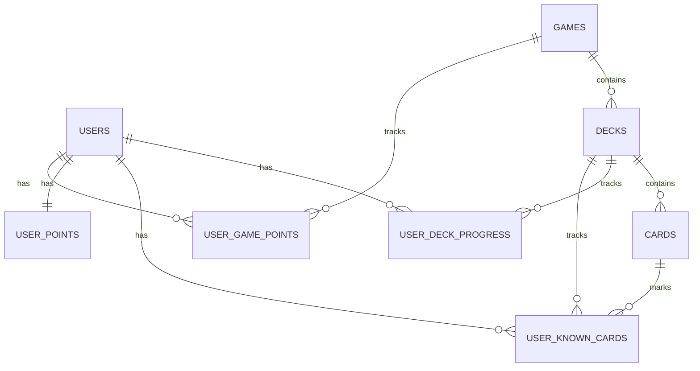

Important tables:
- `users`
- `games`
- `decks`
- `cards`
- `user_deck_progress`
- `user_known_cards`
- `user_points`
- `user_game_points`
- `idempotency_keys`

## API Interaction Sequences

### Register

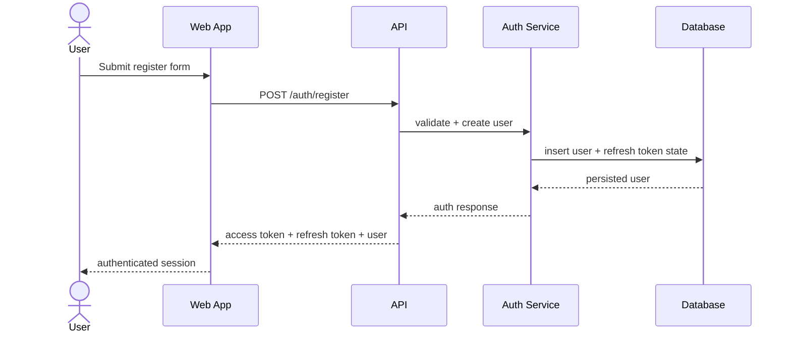

### Login And Session Restore

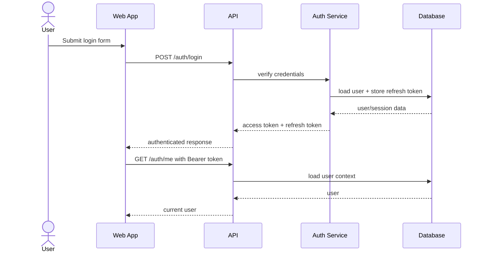

### Flashcards Load

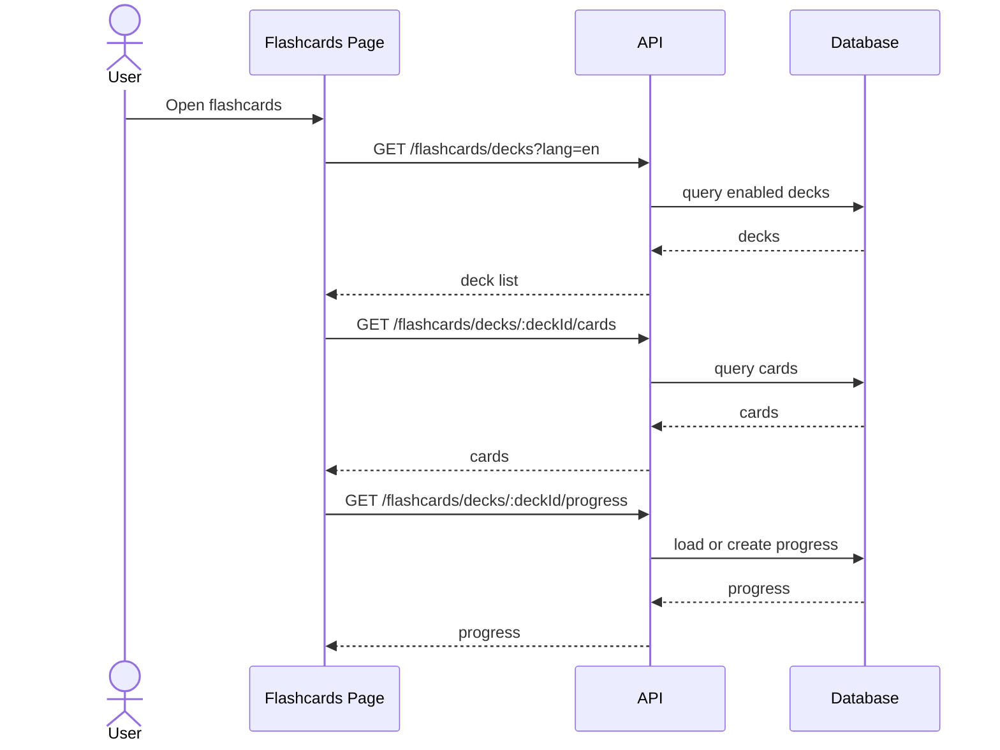

### Mark Known With Idempotency

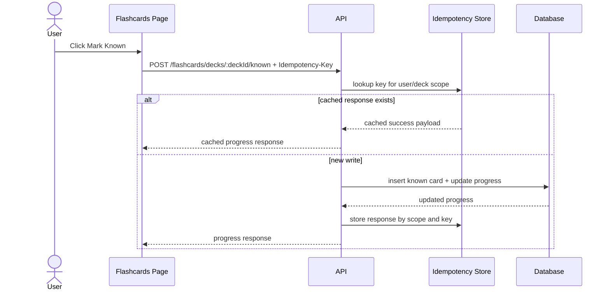

### Offline Queue Replay

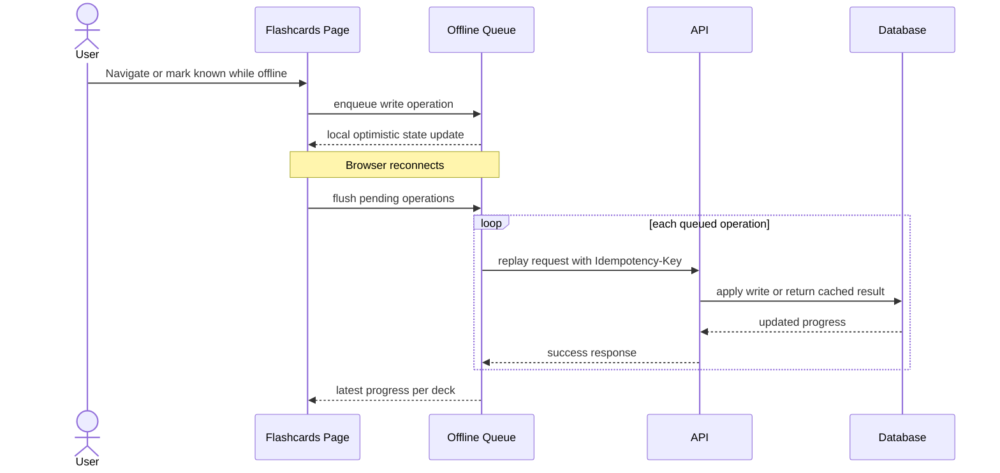

## Testing Architecture

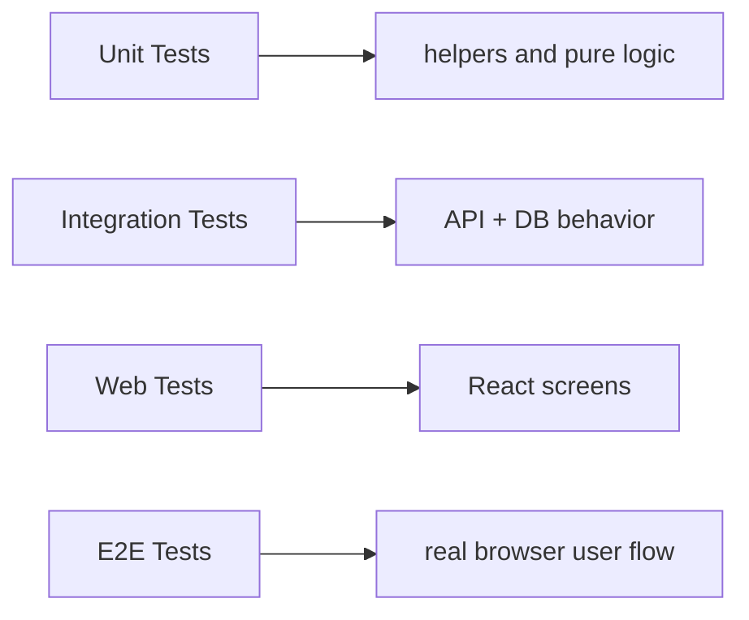

Test roles:
- unit tests cover auth helpers and offline queue logic
- integration tests cover auth, DB, and flashcards API behavior
- web tests cover auth and flashcards UI behavior
- Playwright covers register, open deck, mark known, reload, and persisted progress

## Deployment Notes

- Caddy serves built frontend assets
- Caddy proxies `/api/*` to the API container
- API can auto-run migrations and seed data on startup
- Postgres is the durable store
- Valkey is provisioned for future hot-state use, but current MVP logic does not depend on it

## Current Architectural Gaps

- no points service yet
- no rate limiting yet
- no active Valkey-backed behavior yet
- no `/metrics` endpoint
- only one game is implemented
